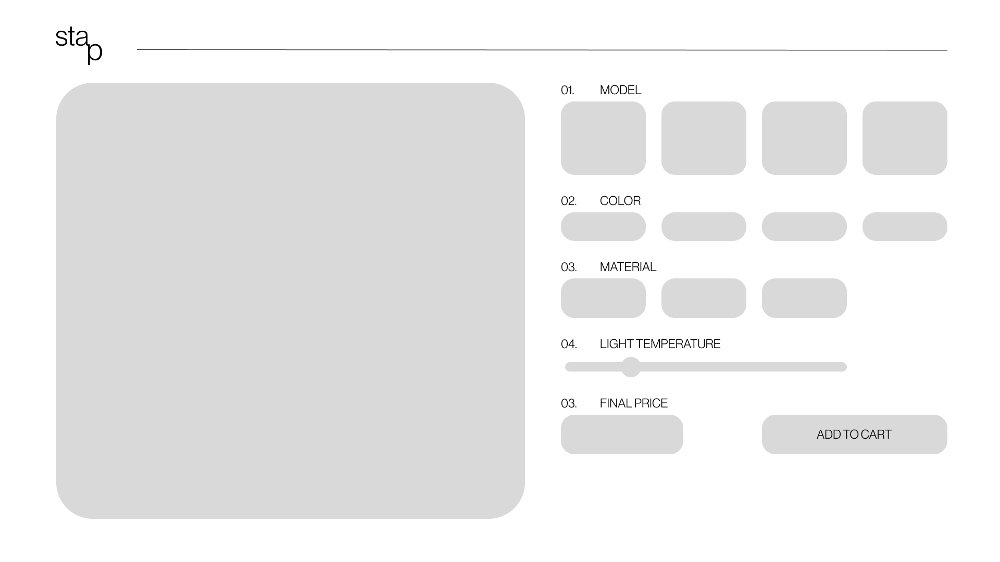
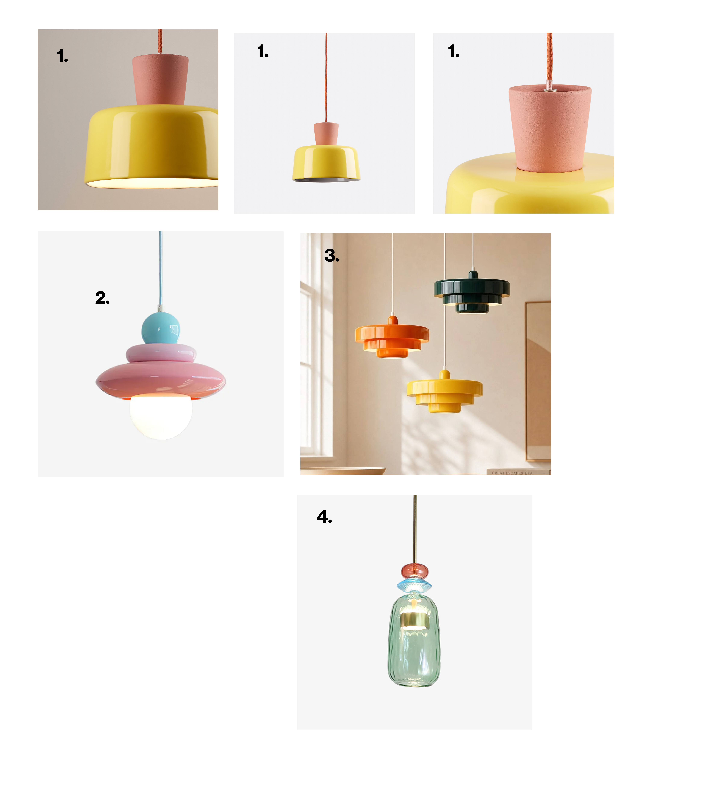
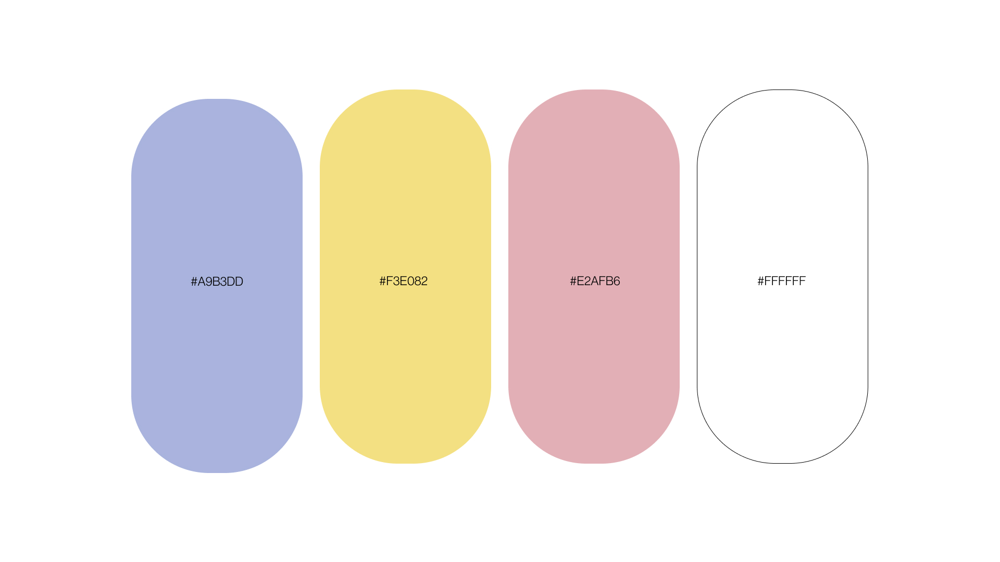
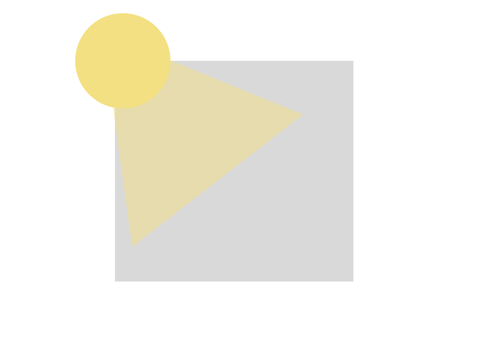
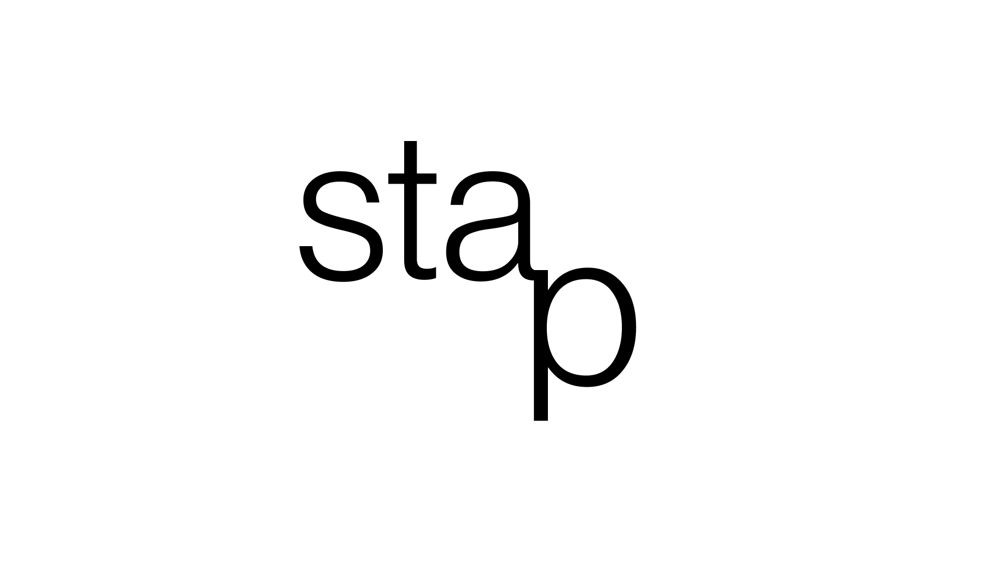
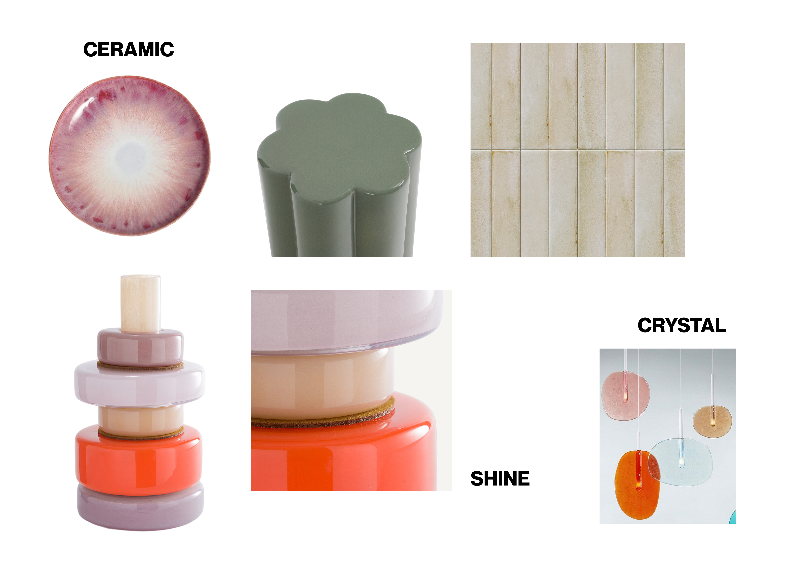
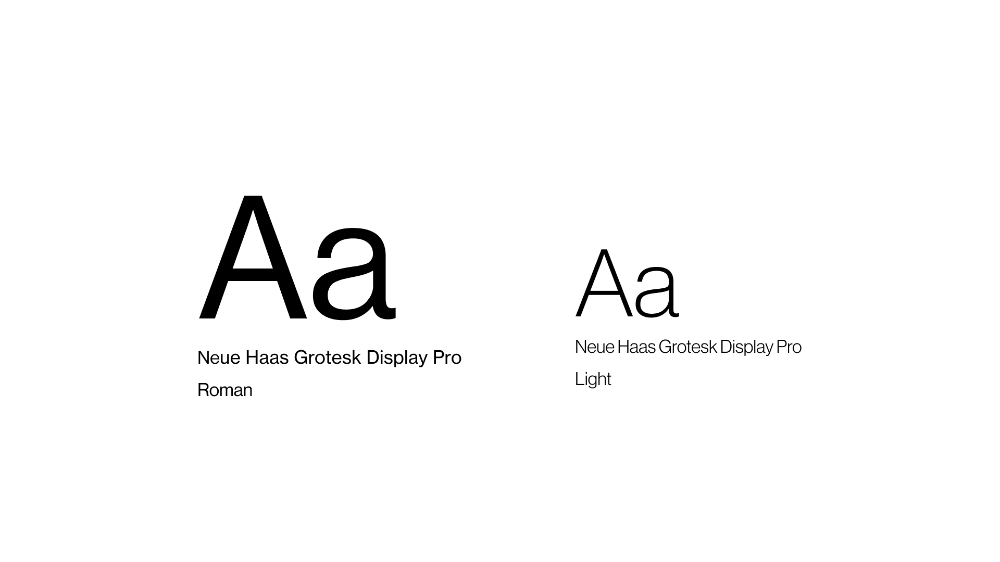

# 3D Lamp Configurator

## UI/LAYOUT

The interface should feel clean and minimal, with the 3D lamp as the main focus and the controls (to the right) clearly separated from the viewer.

## Lamp References

The lamps should feel sculptural, contemporary and playful, with strong silhouettes and simple geometric forms. There are 4 clearly different models.

## Color palette

A colorful scheme, with hex numbers: #A9B3DD #F3E082 #E2AFB6 #FFFFFF #000000

## Lighting

Warm and not very strong light hits the object from its left

## LOGO

Simple logo and shown in the top left corner of the screen/layout

## Materials

Materials that the user can choose from, ceramic, crystal, matte, shine

## TYPOGRAPHY

Neue Haas Grotesk Display Pro (55 Roman) for titles and Neue Haas Grotesk Display Pro (45 Light) for body text 

# 3D Lamp Configurator — Project Plan

## 1. Project Overview

The project is an interactive 3D configurator for a lighting brand.

Users will be able to explore a lamp in 3D and customise different elements of the product before choosing their final configuration.

The experience should feel simple, visual and design-focused rather than technical.

### Main Goal

Create an interactive product experience where users can:

- View the lamp in 3D
- Rotate and explore the product
- Change its configuration
- Compare different combinations
- Create a personalised version of the lamp